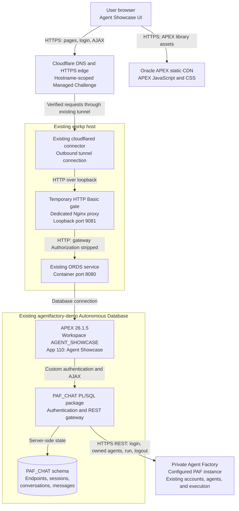

# Agent Showcase — APEX architecture

Agent Showcase gives a signed-in Private Agent Factory (PAF) user a dedicated chat interface for their **owned, published agents**. It connects to an administrator-approved PAF instance.

This document records the implementation deployed on **2026-10-19**, with multi-instance login verified on **2026-10-20**. It is repository documentation under `integrations/`; it is not an agent sample or an entry in the generated GitHub Pages catalog.

## User flow

1. Complete Cloudflare human verification. Managed Challenge may verify the browser automatically or request an interaction.
2. Pass the browser's temporary proxy username/password prompt.
3. On the APEX landing page, enter a registered PAF instance URL or use the configured default. Both an HTTPS root URL and its `/agentFactory` base path are accepted.
4. Continue and sign in with the existing PAF email and password. No separate APEX end-user account is required.
5. Choose from agents that PAF identifies as both owned by this user and published.
6. Chat with the selected agent through PAF REST APIs.
7. Reopen conversations for that agent from the collapsible left sidebar, or start a new conversation.

**History currently covers conversations started through this APEX app.** Importing earlier PAF conversations is pending a decision about adding authenticated REST history endpoints to PAF; the inspected installation exposes existing history through Socket.IO. The current app does not modify the PAF runtime.

## Component diagram



The browser receives an APEX session cookie. The database-side gateway holds the PAF session cookie and makes authenticated REST requests to PAF. Agent execution, model configuration, tool credentials, and tool permissions remain with the selected agent in PAF.

| Component | Responsibility |
| --- | --- |
| Browser UI | Two-step URL/login form, searchable agent cards, messages, new conversations, and collapsible history. Application CSS/JavaScript are APEX static files. |
| Cloudflare | Public DNS/HTTPS, Managed Challenge for the app hostname, and a route through the existing workp tunnel after verification. |
| Dedicated Nginx proxy | Requires the temporary HTTP Basic account before the landing page, APEX pages, forms, AJAX, logout, and health response. Routes authenticated requests to ORDS and strips the gateway credentials. |
| ORDS | Serves APEX pages, application static files, native form submission, and AJAX requests. |
| APEX app 110 | Login page **9999** behind the proxy gate, authenticated workspace page **1**, custom PAF authentication, and the page-level `PAF_API` AJAX process. |
| `PAF_CHAT` package | Endpoint validation, PAF authentication, server-side session lookup, agent authorization, REST calls, and conversation persistence. |
| PAF | Existing user authentication, user-specific agent metadata, and agent execution through the REST run endpoint. |

## Authentication and chat sequence

```mermaid
sequenceDiagram
    actor User
    participant UI as Browser / APEX UI
    participant Edge as Cloudflare edge
    participant Proxy as Temporary proxy gate
    participant App as APEX app 110 / PAF_CHAT
    participant Store as PAF_CHAT tables
    participant PAF as PAF REST API

    User->>UI: Open application
    UI->>Edge: Request landing page
    Edge-->>UI: Managed Challenge
    Note over UI,Edge: Automatic browser verification or user interaction
    UI->>Edge: Complete verification and obtain clearance
    Edge->>Proxy: Request landing page
    Proxy-->>UI: HTTP 401 Basic challenge
    User->>UI: Enter temporary gateway credentials
    UI->>Edge: Retry with clearance and HTTP Basic credentials
    Edge->>Proxy: Forward verified request
    Proxy->>App: Forward after validation; strip gateway Authorization
    App-->>UI: PAF instance and sign-in form
    Note over UI,Proxy: Subsequent requests require edge clearance and the proxy gate

    User->>UI: Enter instance URL, then PAF email and password
    UI->>App: Native APEX login over HTTPS
    App->>Store: Resolve root or context URL against PAF_ENDPOINTS
    App->>PAF: GET /v1/loginValidation (Basic credentials)
    PAF-->>App: Valid user ID and PAF session cookie
    App->>Store: Bind PAF session to authenticated APEX session
    App-->>UI: Authenticated page and APEX session cookie
    Note over UI,App: Password is memory-only. PAF cookie stays server-side

    UI->>App: PAF_API: bootstrap
    App->>PAF: GET /v1/users/{userId}/agents (PAF cookie)
    PAF-->>App: User-specific agent metadata
    App-->>UI: Only owned and published agents

    User->>UI: Select agent and send message
    UI->>App: PAF_API: send (agent, message, optional room)
    App->>Store: Validate session, identity, and expiry
    App->>PAF: Re-fetch user's agents
    App->>App: Require current ownership and publication
    opt Continue an existing conversation
        App->>Store: Verify instance + username + agent + room
    end
    App->>PAF: POST /v1/agentBuilder/run/{agentId}
    PAF-->>App: roomId and assistant message
    App->>Store: Commit conversation and user/assistant messages
    App-->>UI: Render response and refresh sidebar

    User->>UI: Reopen conversation
    UI->>App: PAF_API: messages (agent, room)
    App->>PAF: Re-check owned and published agent
    App->>Store: Read messages in current user's conversation
    App-->>UI: Stored messages in order
```

The sequence shows the initial edge and proxy challenges and omits repeated proxy/edge hops for readability; browser requests use the component path above. There is no browser-to-PAF authentication or chat request in this implementation.

## REST and AJAX contracts

All PAF paths below are relative to the configured, allowlisted PAF base URL, including its `/agentFactory` context path.

| Purpose | PAF request | Application behavior |
| --- | --- | --- |
| Authenticate | `GET /v1/loginValidation` with Basic credentials | Requires a valid response, user ID, and `agent_factory_session` cookie; binds the result to the authenticated APEX session. |
| Discover and authorize agents | `GET /v1/users/{authenticatedUserId}/agents` | Filters `data.items` by `isOwner` and `published`; the global `/v1/agents` list is not used to prove ownership. |
| Send or continue chat | `POST /v1/agentBuilder/run/{agentId}` | Sends `{"message":"..."}` for a new chat, or includes `"roomId":"..."` when continuing. Reads the returned `roomId` and structured `message`. |
| Sign out | `GET /logout?local_only=true` | Attempts PAF logout, deletes the app's stored session, then uses native APEX logout. |

The browser calls `apex.server.process('PAF_API', ...)` on authenticated page 1. `x01` selects `bootstrap`, `history`, `messages`, `send`, or `logout`; `x02`, `x03`, and `x04` carry the agent ID, room ID, and message respectively. These client values are selectors, not authorization evidence. The package obtains the username, PAF user ID, instance, and PAF cookie from the authenticated server-side session.

`history` and `messages` read local app tables after checking the current PAF agent permissions. They are not calls to an existing PAF REST history API.

## Data and isolation

The isolated schema contains four tables:

| Table | Stored data and key |
| --- | --- |
| `PAF_ENDPOINTS` | Allowed PAF base URLs and default marker; primary key `base_url`. The login page's initial URL is also defined in the app generator. |
| `PAF_SESSIONS` | APEX session ID, normalized username, PAF user ID, base URL, PAF cookie, and expiry; primary key `apex_session_id`. |
| `PAF_CONVERSATIONS` | Instance, username, agent ID, PAF room ID, title, and update time; primary key `(base_url, username, room_id)`. History is additionally filtered by agent ID. |
| `PAF_MESSAGES` | Ordered user/assistant content and timestamps, with an identity `message_id` and foreign key to the instance/user/room conversation. |

The current username and instance scope every conversation lookup. Reading or continuing a room also requires the selected agent to match that conversation. Current ownership and publication are rechecked on every chat/history request, so an old local conversation does not grant access to an agent that is no longer eligible.

A new conversation omits `roomId`; the returned PAF room ID becomes the local conversation ID. The first user prompt supplies its title. Reopening history reads the persisted transcript; sending another message invokes PAF with that room ID.

Conversation and message rows are committed after a successful PAF response. The PAF request and local database transaction are separate: a network failure can occur after PAF has processed a message. Failed sends are **not retried automatically**. The UI directs the user to check history before retrying. There is no background queue or stream in this version; each run is a synchronous REST request.

## Session and access controls

- An enabled Cloudflare Managed Challenge rule matches only the app hostname and covers direct APEX and static-file requests. Other application hosts keep their existing access paths. Clearance is reused; after it expires, an AJAX request may require a new browser navigation to complete verification.
- The temporary HTTP Basic gate runs in the dedicated proxy and does not use Authentik. It accepts one approved existing account and stores only a salted password hash in private operational state. The deployed hash is readable only by the unprivileged proxy user. Gateway credentials are removed before forwarding requests to ORDS.
- PAF sign-in still identifies the individual app user. APEX sign-out ends the PAF/APEX session; the browser can retain its HTTP Basic credentials for the browser session.
- The proxy sends `Cache-Control: no-store` for app responses. Cloudflare accepted a purge for the app hostname only; the previously cached static-file path now receives the edge challenge before app content is served.
- The URL field accepts a registered HTTPS root or `/agentFactory` URL and resolves it to the exact `PAF_ENDPOINTS` entry before credentials are sent. The build and AIW-PM instances are registered; the build instance remains the default. An unregistered instance receives a configuration message before credential validation. Entering an arbitrary URL does not authorize another destination.
- The browser has the secure APEX cookie `AGENT_SHOWCASE_SESSION`. It does not receive the PAF cookie. Password page items use memory-only APEX session state and are cleared after successful authentication.
- Server-side PAF session rows must match both the authenticated APEX session ID and username. They expire after **170 minutes**. APEX has a **30-minute idle timeout** and **170-minute maximum session length**.
- Logout deletes the stored session even when its local expiry has passed. PAF logout is best effort; it is not a claim of global logout across other PAF browser sessions.
- The database schema uses **NO AUTHENTICATION**, a **100 MB** quota, `CREATE SESSION`, `CREATE TABLE`, `CREATE PROCEDURE`, and execution grants for `SYS.UTL_HTTP` and `SYS.UTL_URL`. Its HTTPS ACL is scoped to each registered PAF host on port **443**.
- Message rendering creates DOM text nodes, including structured tables. Agent-supplied HTML is not executed.
- Expired session rows are removed on a successful sign-in. Conversation records persist; no scheduled retention or deletion job is installed.

## Deployment boundaries

| Setting | Deployed value |
| --- | --- |
| Public app entry | Dedicated application hostname |
| Existing database tools entry | Separate authenticated tools hostname |
| APEX database / version | Existing `agentfactory-demo` Autonomous Database / **26.1.5** |
| Workspace / schema | Separate `AGENT_SHOWCASE` / `PAF_CHAT` |
| Application / alias | **110** / `AGENT-SHOWCASE` |
| Existing workspace retained | `AGENTFACTORY_DEMO` |
| PAF instances | Administrator-registered build default and AIW-PM instance |
| Dedicated origin listener | Loopback port **9081** on the application host |
| Upstream | Existing ORDS container on port **8080** |

The dedicated Nginx container runs as an unprivileged user with a read-only filesystem, temporary writable directories, dropped capabilities, and a pinned image digest. It forwards the APEX entry point for app 110, required native AJAX/form/localization/logout paths, and that app's static files. `/ords/apex_admin` and the builder entry point `/ords/f?p=4500:1` are rejected on the app hostname. APEX library requests under `/i/` redirect to Oracle's static CDN.

The app hostname uses Cloudflare human verification, the temporary proxy gate, and then native PAF login through APEX. The existing database tools hostname keeps its existing Authentik access path. Adding the app route retained unrelated tunnel entries and the final catch-all; it did not replace the shared tunnel configuration or change other application routes.

### Source ownership and operations

Operational sources remain in their owning directories on the deployment workspace; this repository contains this architecture record, not copies of credentials or private runtime state.

| Owner directory, relative to `/home/ubuntu/work` | Important sources |
| --- | --- |
| `apps/apex/agent-showcase/` | `static/`, `sql/schema.sql`, `sql/paf_chat.sql`, `scripts/build_app.py`, `scripts/deploy.py`, `scripts/register_instance.py`, `scripts/verify_browser.py`, `tests/browser_check.py`, `tests/test_instances.py`, `tests/instance_login_check.py`, `exports/f110.sql`, `exports/f110-native.sql`, and `docs/deployment.md`. |
| `infra/ansible/` | `playbooks/deploy_apex_agent_showcase_proxy.yml` and `playbooks/files/apex-agent-showcase-*`, plus `apex-proxy.inc`, `runbooks/apex_agent_showcase_proxy.md`, and `runbooks/apex_showcase_challenge.md`. |
| `infra/cloudflare/` | `apex_showcase_route.py` checks hostname conflicts, tunnel health, local readiness, concurrent updates, and unrelated routes. `apex_showcase_challenge.py` plans, applies, and verifies only the dedicated challenge rule while preserving unrelated rules. |
| `databases/` | Existing shared database connection helpers and clients. |

The schema deployment creates the workspace, app tables/package, grants, and scoped ACL. The initial app import refuses to overwrite an existing application ID. A subsequent `refresh` is restricted to app 110 named `Agent Showcase` in `AGENT_SHOWCASE`; it saves a protected native export first and preserves the conversation tables.

Adding a PAF instance uses `scripts/register_instance.py` to plan or apply its canonical endpoint registration and exact-host port-443 database ACL. Existing registrations and the default are preserved. The landing page accepts the root or context URL of any registered instance without another app refresh. Changing the displayed default is a separate configuration change. Changing the public hostname requires matching app/proxy configuration, the dedicated DNS/tunnel route, and the challenge rule expression. Updating a displayed default alone does not grant access to another PAF instance.

For rollback, remove only the app hostname's current tunnel route and matching DNS record after checking for concurrent changes, then stop only its dedicated proxy if needed. Do not restore an old whole-tunnel snapshot over newer routes. Preserve the database data; dropping the workspace/schema or deleting conversations is a separate destructive operation.

## Verification and limits

The 2026-10-19 public HTTPS checks before challenge deployment used the existing editor PAF account and verified:

- Anonymous and incorrect-password requests to eight landing, page, native form/AJAX, logout, and health entry paths returned HTTP 401. The approved existing gateway credentials allowed the landing redirect and native PAF login; builder/admin paths remained rejected.
- Native APEX login and correct mapping to the authenticated server-side PAF session.
- Exact equality between displayed agent IDs and PAF's owned/published agent IDs; **49** matched at verification time. This is an observed count, not a fixed entitlement or catalog size.
- PAF cookie and password absence from rendered HTML and browser storage.
- Rejection of invalid agent/room IDs and a synthetic conversation belonging to a different username; the synthetic record was removed.
- Live REST replies, reopening an earlier chat, and a new conversation with a different PAF room ID.
- Collapsible navigation, a **390-pixel** viewport without horizontal overflow, expiry rejection, and logout with server-side session deletion.

The full public chat flow passed before the final error-banner adjustment; public sign-in, authorization, mobile layout, expiry, and logout were checked again on the final app definition. Local simulated-API browser checks also passed for structured response rendering, inert HTML injection, and absence of automatic send retries. All deployed PL/SQL objects compiled without errors.

After challenge deployment, fresh public requests to nine landing, APEX, AJAX/form, localization, logout, health, and static entry paths received HTTP 403 with `cf-mitigated: challenge`, without an APEX form or cache HIT. API readback confirmed the enabled hostname-scoped rule and preservation of unrelated rules. The separate tools login path remained reachable. The real password gate, native PAF login, 49 owned/published agents, isolation, mobile layout, expiry, and logout passed again through the local HTTPS adapter. These checks verified public interception and origin behavior separately; they did not complete an interactive human challenge or repeat agent execution.

The 2026-10-20 multi-instance checks passed for a second existing account on both root and context URLs of AIW-PM, and for the editor account on AIW-PM and the build default. Accounts with no owned/published agents still authenticate and see an empty state. Five offline registration tests and ten database URL checks passed. Native failure checks distinguish unregistered/insecure instances from invalid credentials and clear the password. Build retained its 49-agent result and rejected cross-user and cross-instance history access. All nine existing conversations and 18 messages were preserved. These origin browser checks kept the public challenge enabled and did not repeat agent execution.

Private verification records, screenshots, runtime transcripts, credentials, cookies, database connection material, and tunnel tokens are excluded from this repository. These checks establish the initial application flow; they do not validate every agent's business output, tool side effect, long-running execution, or importing pre-existing PAF history.
