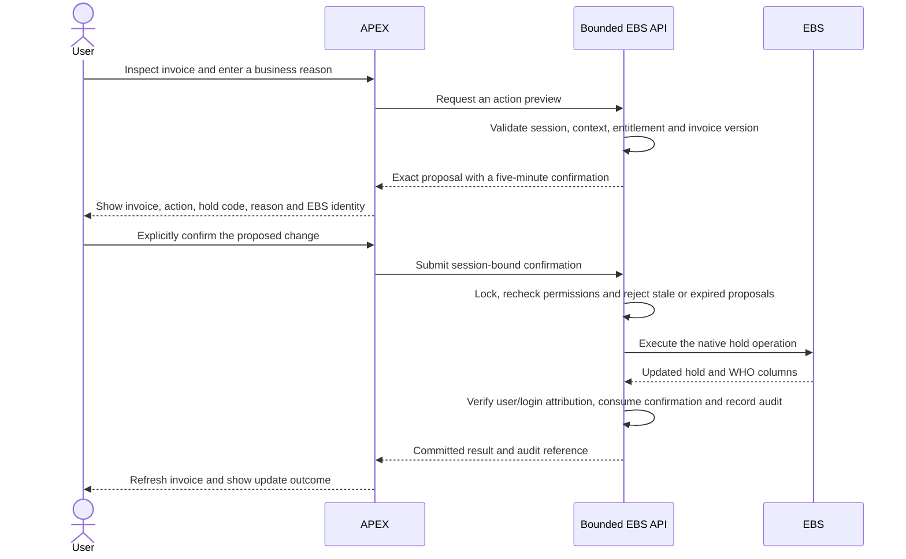

# APEX Payables Workbench architecture

The workbench brings an EBS Payables invoice review into a focused APEX application: a user signs in with an existing EBS account, chooses an assigned responsibility and operating unit, explores balances and aging, opens an invoice, and reviews a proposed hold action before confirming an actual EBS update.

A separate APEX workspace, parsing schema and application keep this workflow independent of the agent-chat application. Authentik is not used for this version. Deployment addresses, credentials and private validation evidence stay in operational configuration outside this repository and GitHub Pages.

## Components and trust boundaries

```mermaid
flowchart LR
    U[Payables user] --> E[Cloudflare browser challenge]
    E --> A[Native APEX application]
    A --> S[Server-side session binding]
    S -->|Authenticated REST over TLS| B[Restricted integration bridge]
    B -->|Fresh encrypted JDBC connection| P[Bounded EBS package]
    P --> I[Native ICX session validation]
    I --> C[Verified user and responsibility]
    C --> M[Authorized operating-unit context]
    M --> Q[Scoped invoice queries]
    M --> H[Native invoice hold APIs]
    H --> W[EBS WHO attribution checks]
    W --> T[Commit and audit]
```

The browser never receives the bridge credential, database password, native EBS session identifier or application session token. APEX keeps its backend token and binding in server-side session storage. The machine REST origin requires its own credential and is separate from the challenged browser origin.

The bridge cannot execute caller SQL or accept a caller-selected database target. Its database account has `CREATE SESSION` and `EXECUTE` on the bounded package. It has no general invoice-table access or APPS credentials. A locked custom owner holds session, confirmation and audit records; EBS customization tables use the editioning registration pattern.

## Same-user context

Authentication happens before context initialization. The installed native `ICX_SEC.VALIDATEPASSWORD` verifies local EBS credentials, checks password expiry, audits sign-on and establishes the native ICX session. The package issues a random application token and retains only its hash, bound to the APEX session binding and verified EBS identity.

Each request checks the token, binding, authenticated APEX principal, absolute/idle expiry, active EBS account and native ICX session. Context selection requires an active direct Payables responsibility assignment. `FND_FUNCTION.TEST` checks invoice and hold permissions; `MO_GLOBAL.INIT('SQLAP')` and `MO_GLOBAL.CHECK_ACCESS` enforce operating-unit access. Queries against `_ALL` objects also include explicit organization predicates.

`FND_GLOBAL.APPS_INITIALIZE` establishes application context but resets the login audit ID. Native ICX validation restores the verified user, responsibility and login context on the same physical connection. A confirmed update must pass both EBS user and native login attribution checks. Native ICX responsibility/organization setters are used during context selection; their commit behavior is kept outside the business-action transaction.

The bridge opens a fresh physical connection for each request. Context initialization, access checks, API execution, readback and cleanup use that connection. Context is cleared on success and error, and the connection is closed. No database link or cross-user connection pool is used.

## Confirmed invoice actions

The initial actions apply a manually releasable invoice hold or release a single eligible manual hold through `AP_HOLDS_PKG`. Native responsibility/function permissions still apply. Releases use the native manual release code; the user’s business justification is retained in the application confirmation record. Cancelled invoices, duplicate active hold codes, ineligible system/line holds and ambiguous multi-row releases are rejected.

The confirmation is tied to the session, responsibility, operating unit, invoice version and stored action parameters. Repeated submission returns the original completed result instead of applying the action again. A changed invoice or hold state requires another review.

## Workflow and reporting

The overview shows positive unpaid exposure, overdue exposure, held invoices and open invoices, with aging and supplier charts. KPI and supplier selections open a filtered, searchable invoice queue. Invoice details include supplier/site, lines, distributions, purchase-order references, schedules, holds, approval history and application activity. The sidebar collapses and the interface adapts to small screens.

Currencies remain separate. The reporting date filters invoice dates and determines aging; balances use current payment-schedule amounts remaining, with the header balance as a fallback for unscheduled invoices. Positive unpaid exposure does not net credit notes and is not a reconstructed historical accounting snapshot. Historical demo dates remain visible. Missing details show an empty state rather than invented records.

## Validation status

The isolated app, package and bridge are deployed. Package compilation, runtime grant checks, machine authentication and rejection of unverified identities passed. Read-only operator report checks reconciled unpaid exposure, aging totals, queue/KPI filters and invoice detail queries against EBS data. These checks do not establish an end-user session. Native authentication and login-context restoration were checked using the stored administrative credential only for its own account; the app correctly excludes administrative accounts.

The browser suite checked native APEX rendering and its path to the EBS account exclusion. Separately labeled fixtures checked charts, queue/detail navigation, cancellation, explicit confirmation controls and responsive layouts. Fixture checks performed no EBS invoice updates.

A complete non-admin Payables login, two-user isolation checks, expiry/logout/replay checks and a real reversible hold/release round-trip remain pending an approved non-admin credential source. Do not treat fixture results or the administrative-account check as evidence that these business scenarios passed.

This document is repository documentation only; it is not part of the agents Pages catalog.
