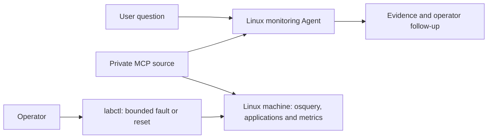

# Linux OS monitoring setup

This operator guide builds a small Linux machine runtime with osquery and six read-only MCP tools. Use the same image and configuration for each target instance. The Agent presents its target as Linux machine **linux-ops-01**, without deployment details. The [native Agent Factory sample](../../agents/linux/os-monitoring/README.md) uses **AIW26-PAF-HOL6004-BOO6096**, configured as an OpenAI Compatible model.



The MCP endpoint is `http://PRIVATE_MONITOR_IP:8085/mcp` using Streamable HTTP. Authentication is deliberately absent for this private connection. Host firewall rules allow only the Factory private source addresses and deny other sources; add matching private OCI ingress only if needed. A private bind address alone does **not** prevent access through an OCI public-IP mapping. No public ingress, tunnel or DNS route is required.

## What the Agent can observe

| Tool | Evidence and limits |
| --- | --- |
| `get_system_overview` | osquery OS identity/version; resource limits, operations filesystem and history coverage |
| `get_resource_usage` | One-second assigned CPU as percent of quota, charged memory, limits and process count |
| `get_top_processes` | osquery top CPU and RSS, at most 10 returned per list from 80 sampled processes; no arguments/environment |
| `get_filesystem_usage` | Bytes and inodes on the dedicated 64 MiB `/var/lib/operations` tmpfs |
| `get_service_network_status` | Orders and inventory HTTP health on 8081/8082, three background jobs and osquery listeners |
| `get_recent_history` | Actual resource/disk samples every 10 seconds, retained for 30 minutes, at most 181 rows |

Measurements are real observations of simulated workloads. They do not represent the surrounding infrastructure. The container shares the host kernel; CPU/memory use cgroups v1/v2 rather than host `/proc/meminfo`. Memory includes charged cache and tmpfs and can exceed summed RSS. The operations filesystem is RAM-backed, independent of the host disk. History survives questions but resets on container restart, has only the coverage actually collected, and records failures as gaps/errors.

Illustrative pressure thresholds: CPU/memory at least 75% of the assigned limit, operations filesystem at least 85% used. These are advisory thresholds. A short spike does not establish sustained pressure; increasing memory does not establish a leak.

## Application activity

Five small applications run continuously: `orders-api` (8081), `inventory-api` (8082), `job-worker`, `report-cron` and `log-forwarder`. The worker sends local API requests, the scheduler updates one small report and the logger rotates three files of at most 256 KiB each. Fixed touched caches total 24 MiB, in addition to Python process overhead. Random short work bursts and jitter produce changing counters and observations; no external traffic or downloads are generated.

The supervisor restarts failed applications. Fault changes leave the other application processes running; a service outage affects only `orders-api`, and expiry/reset restores it. Baseline resource use and memory headroom are verified by `scenario_check.py`. Ask “Which applications and background jobs are running? Explain their roles, process IDs and recent activity.”

## Build and deploy

The canonical host automation is `~/work/infra/ansible/playbooks/deploy_linux_monitoring_lab.yml`. Its system service preserves the existing rootless Factory deployment. For cgroup v1, use a separate **rootful Podman engine** to enforce limits; the container itself runs as UID 10001 without capabilities, host mounts, host PID/network namespaces or a container socket.

From the infrastructure checkout:

```bash
cd ~/work/infra/ansible
ansible-playbook playbooks/deploy_linux_monitoring_lab.yml --syntax-check
ansible-playbook playbooks/deploy_linux_monitoring_lab.yml -e lab_hosts=YOUR_MONITOR_HOST --limit YOUR_MONITOR_HOST --check --diff
ansible-playbook playbooks/deploy_linux_monitoring_lab.yml -e lab_hosts=YOUR_MONITOR_HOST --limit YOUR_MONITOR_HOST
```

For another target host, override the play's host pattern with `-e 'lab_hosts=YOUR_INVENTORY_GROUP'`, set `linux_lab_bind_ip`, `linux_lab_allowed_sources` to that Factory's private IP/CIDRs, and `linux_lab_allowed_origins` to its UI origin. Always use an explicit `--limit`. The source path variable `linux_lab_source` points to this integration folder. Ensure the appropriate private route and OCI rules exist in `~/work/infra/oci`; do not open the port to `0.0.0.0/0`.

For an independent deployment on an x86_64 host:

```bash
cd integrations/linux-os-monitoring
sudo podman build -t localhost/linux-monitoring-lab:1.0 .
# Loopback first; configure host/OCI source restrictions before using a private IP.
sudo env LAB_BIND_IP=127.0.0.1 ./run-container.sh
```

The pinned osquery 5.23.1 amd64 DEB is checksum-verified during the build. The MCP SDK is pinned to 1.26.0. The image targets amd64; an ARM port needs its matching DEB and checksum. The kernel/cgroup parser supports v1 and v2; this does not imply that every rootless runtime can enforce limits.

The runtime limits are one CPU, 1536 MiB memory with no additional swap, 128 pids, read-only root, a 64 MiB operations filesystem, 32 MiB runtime state and 128 MiB temporary filesystem. User-mode `slirp4netns` networking keeps published connections on the host INPUT firewall path. Do not replace it with bridge publishing without accounting for forwarding/DNAT firewall behavior.

## Connect Factory and import the Agent

1. Check Factory's outbound URL settings. This HTTP connection requires **ALLOW_INSECURE_HTTP_URLS=true** and private destinations permitted (**BLOCK_PRIVATE_OUTBOUND_URLS=false**). Enabling HTTP is an administrator change that applies to the whole instance, including other outbound integrations. Record the previous value and obtain the instance owner's approval; the source firewall remains restricted to the explicit private sources. If the instance must remain HTTPS-only, provide a private HTTPS endpoint with a certificate trusted by Factory before connecting. The current instance has approved HTTP access enabled and its private MCP source connected.
2. Add an MCP source **Linux OS Monitoring** with the private `/mcp` URL and **Direct connection**. No authentication fields are needed.
3. Discover the six tools above. If discovery is empty, test connectivity from the Factory host/container, check private source firewall/OCI rules and inspect lab logs. The endpoint validates Host and, when supplied, Origin headers.
4. Import `linux-os-monitoring.paf` from a repository release using the shared archive passphrase. For a source build, use the repository [release instructions](../../README.md#build-and-inspect-archives).
5. In Builder, reselect this instance's MCP source and all six allowed tools. Set the Agent model to **AIW26-PAF-HOL6004-BOO6096**. Source IDs and model credentials are environment-local and are not bundled.
6. Disable Agent Memory and cross-thread sharing. These switches are not in the native export. Expand Agent description for the walkthrough and sample questions, then use Playground. The saved draft remains available for review before publishing.

The graph reads left to right: question and MCP tools → monitoring Agent → response. Numbered sticky notes sit above each stage with space around the component cards.

## Demonstrate and reset faults

On the monitoring host, execute these operator commands in a second terminal. There is no fault-control tool in MCP.

| Scenario | Operator command | Expected measured evidence |
| --- | --- | --- |
| Baseline/reset | `sudo podman exec linux-monitoring-lab labctl reset` | Low workload, disk space available, both APIs and all three background jobs active |
| High CPU | `sudo podman exec linux-monitoring-lab labctl cpu` | `batch-indexer` consuming roughly 80% of one core; monitoring overhead can add to it |
| Growing memory | `sudo podman exec linux-monitoring-lab labctl memory` | Touched allocation ramps to 1152 MiB in about 15 seconds; `cache-builder` RSS rises |
| Nearly-full disk | `sudo podman exec linux-monitoring-lab labctl disk` | 58 MiB of real blocks on the 64 MiB operations tmpfs (about 91%) |
| Stopped service | `sudo podman exec linux-monitoring-lab labctl service-down` | HTTP 8081 unavailable and listener absent; inventory 8082 and MCP 8000 stay available |
| Operator status | `sudo podman exec linux-monitoring-lab labctl status` | Scenario, expiry and child PIDs; status is not exposed to the Agent |

Each fault defaults to 180 seconds and automatically resets. `--seconds 10` through `--seconds 300` overrides the duration. One scenario is active at a time; switching terminates its predecessor and removes only the known fill file. Explicit reset restores the service. For history comparisons, keep a scenario running at least 30 seconds, then ask a matching sample question. Memory/disk pressure may take a few seconds to settle after reset.

Useful prompts:

- “Give me a health summary of this Linux machine: CPU, memory, disk and applications. State the observation time.”
- “CPU looks busy. Which processes explain it, and does recent history show sustained pressure?”
- “Is memory increasing? Compare actual available samples; do not infer a leak.”
- “Is the operations filesystem nearly full? How much space remains, and which filesystem did you measure?”
- “The orders application is unavailable. Is its service listening, and are inventory and monitoring still reachable?”
- “Which applications and background jobs are running? Explain their roles, process IDs and recent activity.”

## Validate and operate

```bash
python3 -m unittest discover -s integrations/linux-os-monitoring/tests -v
python3 -m venv /tmp/linux-monitoring-client
/tmp/linux-monitoring-client/bin/pip install -r integrations/linux-os-monitoring/requirements.txt
/tmp/linux-monitoring-client/bin/python integrations/linux-os-monitoring/smoke_client.py \
  --url http://PRIVATE_MONITOR_IP:8085/mcp
# Run the client from an allowed source or through an SSH tunnel.
```

With the integration dependencies installed, the test command also checks ASGI startup/shutdown and ensures subsequent MCP requests cannot duplicate background workers. To exercise all faults as an operator, run the supplied script inside the container (about two minutes):

```bash
sudo podman exec -i linux-monitoring-lab python - < scenario_check.py
```

This check temporarily changes the scenario and resets it on exit. It is separate from the six read-only MCP tools.

`/healthz` returns 200 only with a fresh successful sample and a fresh workload supervisor heartbeat, before any MCP session is opened. Inspect `sudo journalctl -u linux-monitoring-lab` and `sudo podman logs linux-monitoring-lab`. `sudo systemctl restart linux-monitoring-lab` resets the lab and its history. Reapplying the playbook with unchanged sources/config should report no changes; changed sources rebuild the image and restart only this service.

Before a workshop, exercise all five scenarios, verify Factory answers from actual tool evidence, reset, and check that memory is released, disk space returns and the service listens again. Verify the configured CPU/memory/pids limits and source firewall rules; test a disallowed client as well. Live results and limitations are recorded in [validation](../../agents/linux/os-monitoring/assets/validation.md).

Rollback: stop/disable `linux-monitoring-lab.service`, remove only its systemd unit and its three generated firewall rules, reload systemd/firewalld, and optionally remove its image/build directory. Remove the lab's Factory draft/source. If an administrator enabled HTTP solely for this lab, restore its recorded previous value after checking other integrations' requirements. Use the infrastructure runbook for exact environment values. This leaves existing Factory containers alone.

References: [osquery SQL](https://osquery.readthedocs.io/en/stable/introduction/sql/), [process field units](https://github.com/osquery/osquery/blob/5.23.1/specs/processes.table), [Linux cgroup v2](https://docs.kernel.org/admin-guide/cgroup-v2.html), [MCP transports](https://modelcontextprotocol.io/specification/2025-11-25/basic/transports).
